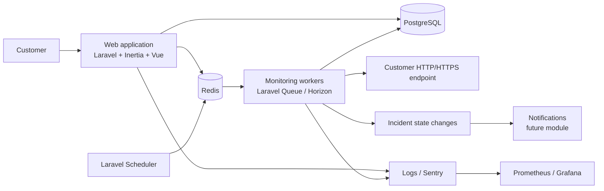

# PulseMonitor Architecture

## Context

PulseMonitor monitors customer-owned websites and HTTP APIs. A user belongs to an organization, creates monitors within that organization, and views the resulting checks and incidents through the web application.

The initial system is a modular monolith. This is an intentional starting point: the domain is still being validated, and a single deployable application reduces operational complexity. Modules communicate through explicit application services and events so that high-volume workers or notification delivery can be separated later without redesigning the domain.

## System context



## Runtime components

### Web application

The Laravel application handles authentication, organization-scoped authorization, monitor CRUD, dashboard queries, and HTTP request validation. Inertia delivers server-routed pages backed by Vue components and TypeScript.

### Monitoring scheduler

The Laravel scheduler periodically finds enabled monitors whose `next_check_at` is due. It dispatches one job per eligible monitor and advances scheduling state in a transaction.

### Monitoring worker

Queue workers execute checks asynchronously. A worker validates the monitor's target again immediately before making the request, performs the HTTP request with a strict timeout, records the result, and passes the result to incident state processing.

### PostgreSQL

PostgreSQL is the source of truth for users, organizations, memberships, monitors, checks, incidents, and scheduling metadata. Organization ownership is represented in the relational model and enforced through policies in the application layer.

### Redis

Redis backs queue transport, Horizon metadata, short-lived locks, and cache entries. Durable monitoring history must never exist only in Redis.

## Module boundaries

```text
App/
├── Identity        authentication and users
├── Organizations   memberships and organization access
├── Monitors        monitor configuration and lifecycle
├── Monitoring      scheduling, HTTP checks, and SSRF defenses
├── Incidents       failure thresholds and recovery transitions
├── Notifications   future delivery channels
└── Shared          cross-cutting contracts and infrastructure
```

Modules may depend on shared infrastructure and stable contracts, but should not reach directly into another module's persistence details. Cross-module behavior should use application services or domain events.

## Core data flow

1. An authenticated user creates or updates a monitor inside an organization.
2. Authorization verifies organization membership and the monitor's ownership.
3. The scheduler selects due, enabled monitors and dispatches idempotent check jobs.
4. The worker validates the destination, performs the request, and records a `MonitorCheck`.
5. Incident processing applies consecutive-failure and recovery rules.
6. An incident transition is persisted and emits an event for future notification handlers.
7. The dashboard reads organization-scoped monitors, recent checks, and incidents.

## Reliability decisions

- Check jobs are idempotent and use a monitor-level lock to avoid duplicate concurrent requests.
- Retries apply to worker/infrastructure failures, not blindly to every target response.
- Check timestamps and sequence data allow delayed or out-of-order jobs to be rejected safely.
- Incident transitions use database transactions and conditional updates to avoid duplicate open incidents.
- A monitor check records outcome, status code, latency, error classification, and timestamps for diagnosis.

## Security decisions

User-provided targets are an outbound-request security boundary. The monitoring service must:

- Allow only `http` and `https`.
- Reject loopback, private, link-local, multicast, reserved, and cloud metadata addresses.
- Resolve and validate DNS addresses before connecting.
- Re-validate every redirect destination.
- Enforce connection and total request timeouts.
- Limit request frequency and response size.
- Avoid forwarding customer credentials or internal headers.
- Record safe error information without storing secrets.

These checks belong in the monitoring boundary, not only in form validation, because jobs can be retried or dispatched through other entry points.

## Scaling path

The first deployment can run the web process, scheduler, and workers as separate containers from the same image. If load grows, the following can scale independently:

- Monitoring workers by queue and geography.
- Read-heavy dashboard queries through read replicas or precomputed aggregates.
- Incident and notification processing through separate queues.
- Monitoring execution into a dedicated service while retaining the same check and incident contracts.

## Observability

Every check should expose structured logs and metrics for monitor ID, organization ID, outcome, status code, latency, queue latency, and error class. Sensitive URLs, authorization headers, and response bodies must be redacted. Sentry captures unexpected application failures; Prometheus and Grafana track worker health, check latency, failure rates, queue depth, and incident transitions.

## Architecture decisions

### Modular monolith first

The MVP favors clear internal boundaries over premature service decomposition. This minimizes deployment overhead while keeping the monitoring and incident workflows independently testable and extractable.

### PostgreSQL as durable truth

Checks and incident history are operational records, so they belong in PostgreSQL. Redis is intentionally limited to transient coordination and queue concerns.

### Asynchronous checks

Monitoring requests must not run inside a customer-facing web request. Queue workers isolate slow or failing targets and allow execution capacity to be controlled independently.
