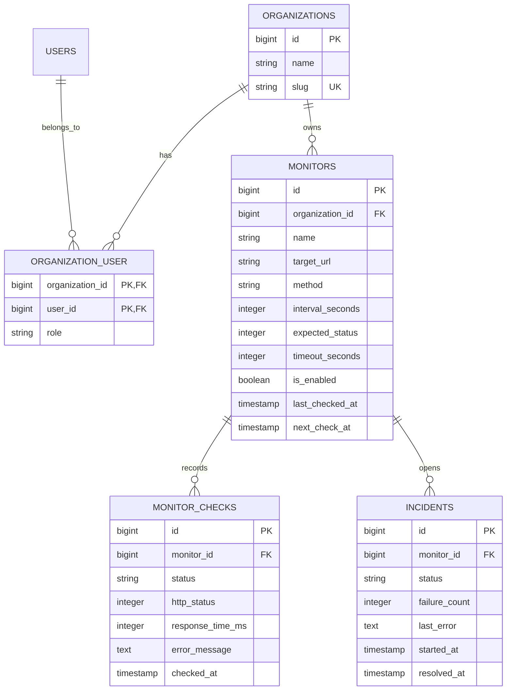

# PulseMonitor Domain Model

The initial domain model supports organization-owned monitors, historical checks, and incidents. Monitoring execution and authorization rules will be added in the next roadmap steps.

